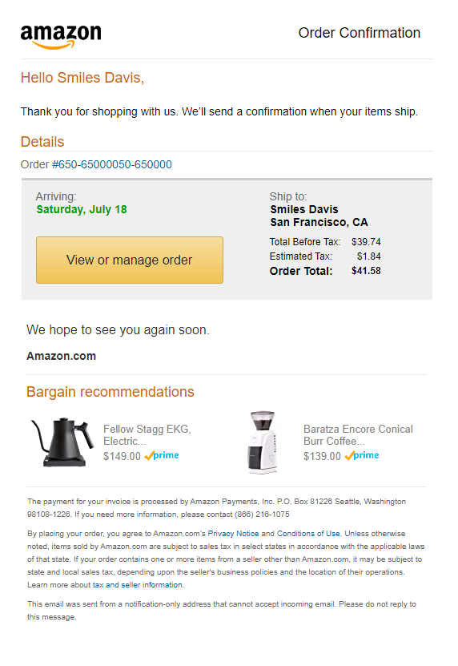
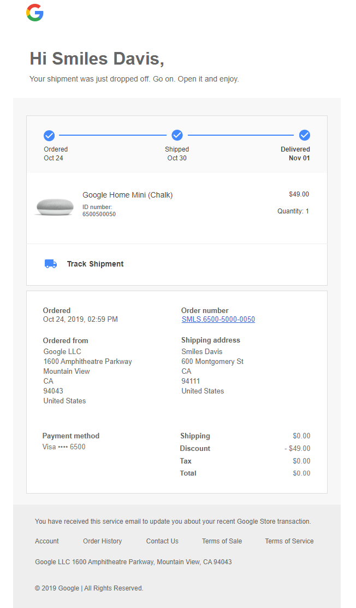
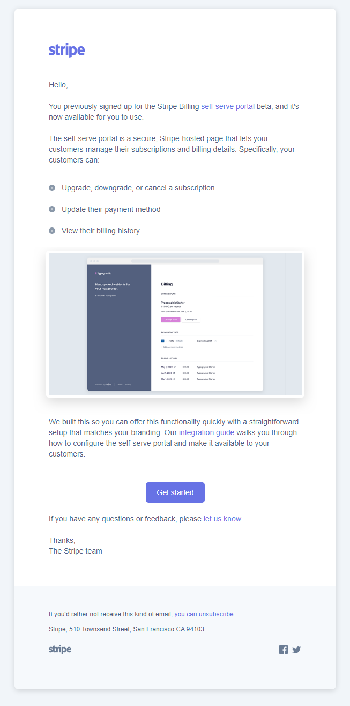
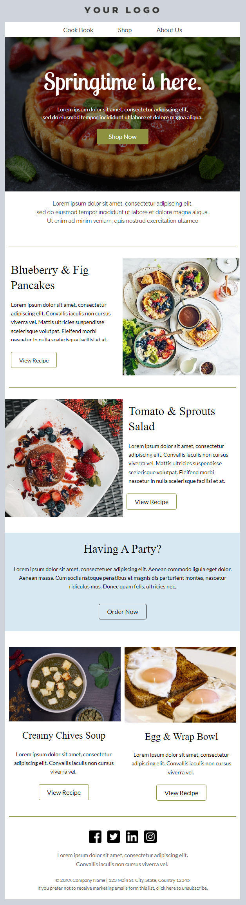
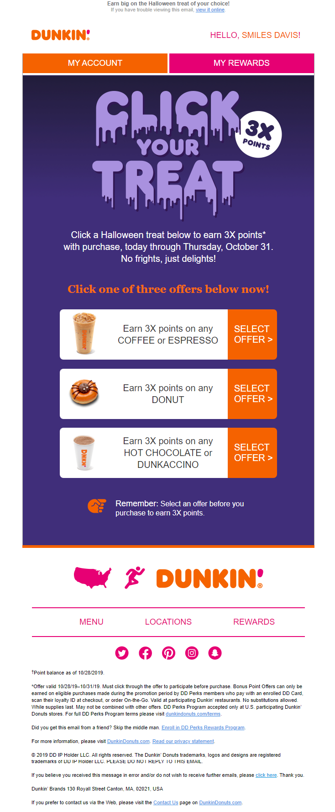
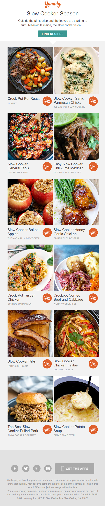
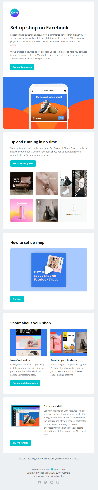
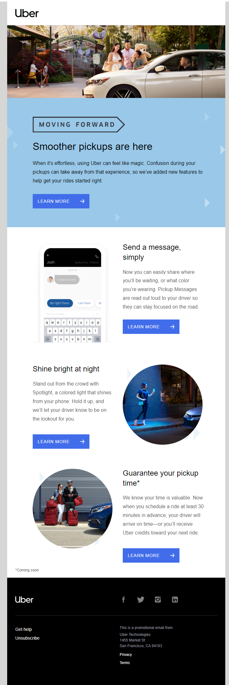

# free-email-templates-to-try

### Note: we didnt own or create those templates. all credits goes to developers/companies that created them and shared for free. Can be outdated or work not ideally.

- https://github.com/designmodo/html-email-templates

- https://github.com/derekpunsalan/responsive-email

- https://designmodo.com/code-responsive-email-template/

- unlayer.com


https://us13.campaign-archive.com/?u=65bd5a1857b73643aad556093&id=d2e761bc33

https://us13.campaign-archive.com/?u=65bd5a1857b73643aad556093&id=8706f5f53a


https://codepen.io/collection/AyVBJr

- https://reallygoodemails.com/

and many more


newsletters:
- https://reallygoodemails.com/emails/the-markup-issue-4

## Examples and screenshots

### Billing 






---

### Food newsletters 








---

### Startups




---


https://www.benchmarkemail.com/

https://www.benchmarkemail.com/email-templates/


#### Arthur Tkachenko articles

* [https://hackernoon.com/5-reasons-why-newsletters-should-be-part-of-your-business-strategy](https://hackernoon.com/5-reasons-why-newsletters-should-be-part-of-your-business-strategy)
* [https://hackernoon.com/organizing-an-advanced-structure-for-html-email-template](https://hackernoon.com/organizing-an-advanced-structure-for-html-email-template)
* [https://hackernoon.com/how-i-started-to-build-react-components-for-email-templates](https://hackernoon.com/how-i-started-to-build-react-components-for-email-templates)
* [https://hackernoon.com/introducing-a-simple-npm-module-with-email-templates](https://hackernoon.com/introducing-a-simple-npm-module-with-email-templates)
* [https://hackernoon.com/glossary-for-non-technies](https://hackernoon.com/glossary-for-non-technies)
* [https://hackernoon.com/email-marketing-and-how-to-curate-an-effective-business-newsletter](https://hackernoon.com/email-marketing-and-how-to-curate-an-effective-business-newsletter)
* [https://hackernoon.com/exploring-substack-for-building-your-newsletter](https://hackernoon.com/exploring-substack-for-building-your-newsletter)
* [https://hackernoon.com/building-a-design-system-for-email-templates-react](https://hackernoon.com/building-a-design-system-for-email-templates-react)
* [https://hackernoon.com/together4victory-list-of-email-marketing-tools](https://hackernoon.com/together4victory-list-of-email-marketing-tools)
* [https://hackernoon.com/cool-newsletters-for-developers-part-1](https://hackernoon.com/cool-newsletters-for-developers-part-1)
* [https://hackernoon.com/cool-resources-for-sending-emails](https://hackernoon.com/cool-resources-for-sending-emails)


## Documentation site

The repo has a Docusaurus site that lists every template by category, with a link to open each HTML template in the browser and its source on GitHub.

```bash
npm install
npm start      # dev server
npm run build  # static site in build/
```

`scripts/build-catalog.mjs` runs before every start and build. It copies the templates into `static/templates/` and writes the category pages into `docs/catalog/`; both are generated and git-ignored. Numbered folders such as `01 Food & Recipes` become categories, and everything else at the root goes under Miscellaneous. The site deploys to GitHub Pages from `main` through `.github/workflows/deploy.yml`.
